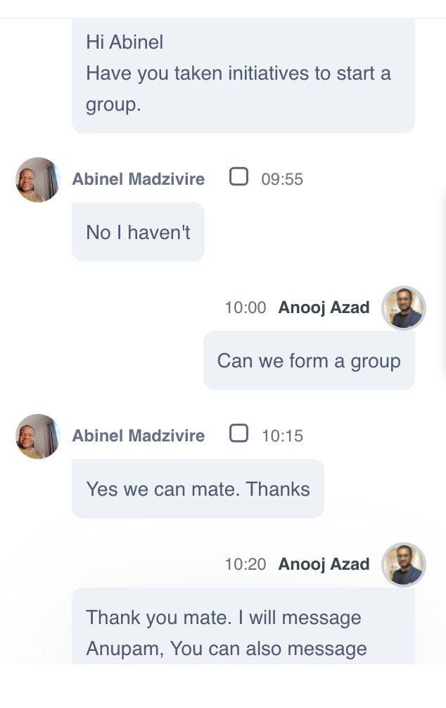
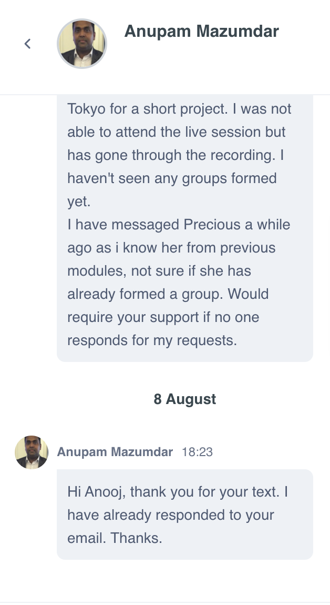
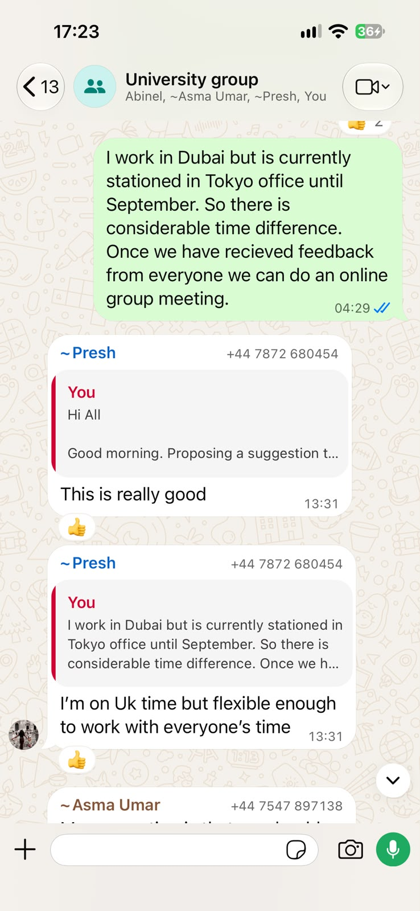
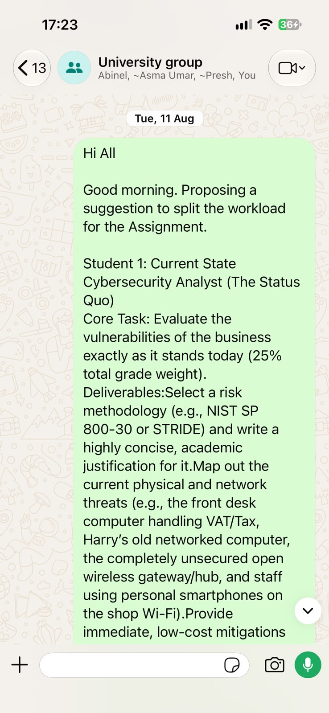
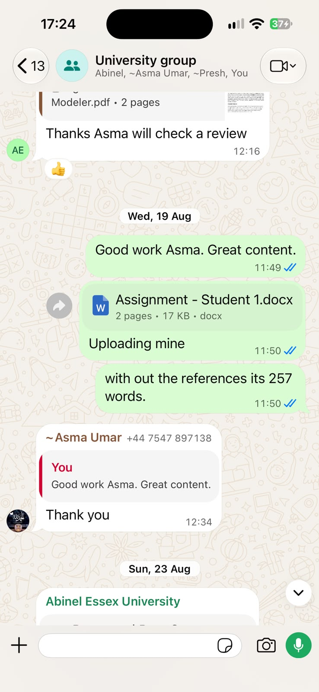
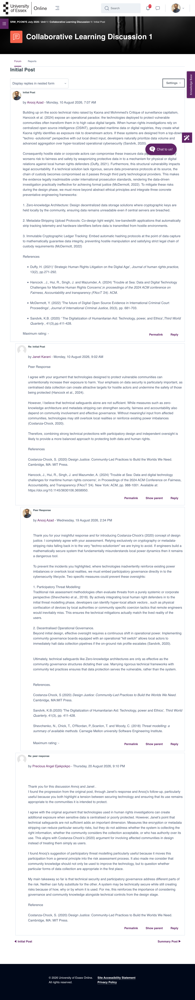

# Module e-Portfolio: Security and Risk Management

---

## 1. Summary of Learning Outcomes
Upon completion of this module, I am able to:
* **Analyse Risks & Vulnerabilities:** Critically identify security risks, threats, and vulnerabilities in information systems, accounting for the current threat landscape.
* **Synthesise Security Intelligence:** Gather and synthesise information from multiple sources (including internet security alerts and warning sites) to aid in systematic risk analysis.
* **Determine Mitigation Methodologies:** Critically determine appropriate methodologies, tools, and techniques (NIST SP 800-30, STRIDE, FAIR) to mitigate security risks and their business impact.
* **Evaluate Professional & Ethical Issues:** Articulate the legal, social, ethical, and professional issues faced by information security and risk professionals.

---

## 2. Unit-by-Unit Summary: Learnings, Challenges & Actions

| Unit | Key Learnings | Challenges Encountered | Actions Taken |
| :--- | :--- | :--- | :--- |
| **Unit 1: Threat Landscape** | Explored the socio-technical risks of digitalisation, referencing Hancock et al. (2024). | Mapping abstract global threats to specific enterprise constraints. | Created a threat taxonomy mapping RaaS and supply chain attacks to our operational context. |
| **Unit 2: Threat Modelling** | Mastered the STRIDE methodology for system decomposition. | Distinguishing between theoretical vulnerabilities and actionable exploits. | Drafted Data Flow Diagrams (DFDs) to systematically identify spoofing and tampering in IoT endpoints. |
| **Unit 3: Data Protection** | Deepened understanding of GDPR requirements and Data Protection Impact Assessments (DPIAs). | Balancing strict privacy regulations with high-availability business requirements. | Authored a DPIA framework specifically addressing cross-border PII transfers for EMEA operations. |
| **Unit 4: Qualitative Risk** | Learned the NIST SP 800-30 qualitative risk assessment framework. | Qualitative matrix labels ("High/Low") proved too ambiguous for budget planning. | Executed the baseline evaluation for our Group 1 project, categorizing current-state vulnerabilities. |
| **Unit 5: Quantitative Risk** | Transitioned to the FAIR framework to calculate Expected Annual Loss (LEF x LM). | Translating qualitative cyber events into mathematical probability distributions. | Pivoted team strategy to utilize Monte Carlo simulations to justify security ROI. |
| **Unit 6: Risk Strategy** | Developed initial status documents and project roadmaps for Kathy's digital storefront. | Aligning 4 distinct team members (Precious, Abinel, Asma, Anooj) on unified goals. | Drafted and proposed the 4-role workload allocation framework successfully adopted by Group 1. |
| **Unit 7: Business Continuity** | Engineered Active-Active Cloud DRaaS concepts to meet RTO/RPO < 1 minute. | Designing for zero-downtime without exceeding projected enterprise budgets. | Outlined a multi-region synchronous replication architecture to ensure failover resilience. |
| **Unit 8: Compliance** | Mapped technical controls against ISO 31000 and Level 1 PCI-DSS standards. | Translating legal/compliance jargon into concrete engineering requirements. | Developed a compliance audit matrix linking specific system configurations to ISO requirements. |
| **Unit 9: Cloud Resilience** | Explored Docker and Kubernetes for containerised workload isolation. | Mitigating the risk of proprietary cloud provider vendor lock-in. | Recommended containerisation strategies to abstract application logic from underlying cloud infrastructure. |
| **Unit 10: Incident Response** | Developed structured Incident Response (IR) playbooks (Detection to Recovery). | Ensuring non-technical executive stakeholders understand escalation paths. | Drafted clear communication trees bridging technical NOC teams with senior enterprise leadership. |
| **Unit 11: Final Evaluation** | Synthesized QRM, DRaaS, and STRIDE into a final cohesive architectural report. | Consolidating disparate group sections into a single unified academic voice. | Acted as technical reviewer, ensuring the financial ROI aligned perfectly with the proposed DR architecture. |
| **Unit 12: e-Portfolio** | Reflected on professional growth using the Rolfe et al. (2001) critical framework. | Condensing 12 weeks of technical and collaborative learning into structured logs. | Built this GitHub Pages repository to systematically document artefacts and PDP goals. |

---

## 3. Detailed Artefacts Log (Units 1–12)

* **Unit 1:** *Global Cyber Threat Landscape Taxonomy* – Mapped modern threat vectors to enterprise digital transformation models.
* **Unit 2:** *STRIDE Threat Model* – Developed DFDs and threat enumeration tables for automated warehouse IoT sensors.
* **Unit 3:** *Data Protection Impact Assessment (DPIA)* – Assessed cross-border PII transfers under GDPR mandates.
* **Unit 4:** *NIST SP 800-30 Qualitative Risk Register* – Executed baseline evaluation of supply chain bottlenecks and vendor lock-in.
* **Unit 5:** *FAIR & Monte Carlo Model* – Calculated probabilistic loss distributions and proved £60k Year 1 Net Benefit.
* **Unit 6:** *Group 1 Status Document* – Established project milestones, role allocations, and preliminary risk assessments.
* **Unit 7:** *Active-Active Cloud DRaaS Blueprint* – Designed multi-region synchronous replication achieving RTO/RPO < 1 min.
* **Unit 8:** *ISO 31000 & PCI-DSS Audit Matrix* – Mapped security controls against international standards.
* **Unit 9:** *Kubernetes & Docker Security Audit Scripts* – Container hardening configurations mitigating vendor lock-in.
* **Unit 10:** *Incident Response Playbook* – Step-by-step containment and legal notification protocols.
* **Unit 11:** *Final Group Project Report* – Consolidated deliverable integrating quantitative FAIR modelling and cloud architecture.
* **Unit 12:** *e-Portfolio Synthesis* – Final reflective review and professional skills matrix.

---

## 4. Group Project Evaluation & Collaboration

### Unit 6 Status Document vs. Unit 11 Final Project Evaluation
* **Risk Assessment:** Shifted from subjective $5 \times 5$ qualitative matrices (Unit 6) to rigorous quantitative FAIR modelling and 10,000-iteration Monte Carlo financial loss distributions (Unit 11).
* **Disaster Recovery:** Evolved from standard warm-standby backups (Unit 6) to a sub-minute Active-Active multi-region DRaaS architecture (Unit 11).
* **Financial Justification:** Added mathematical ROI proof, demonstrating that a £60,000 security control investment reduces Expected Annual Loss from £185,000 to £65,000 (Unit 11).

### Team Collaboration & Meeting Logs
* **Role Allocation:** Formulated the 4-role workload division model adopted by Group 1 (Precious, Abinel, Asma, Anooj), serving as Current State Cybersecurity Analyst.
* **Meeting Syncs:** Weekly collaborative syncs ensured transparent task tracking, peer reviews, and unified report synthesis.

---

## 5. Professional Skills Matrix & Action Plan (PDP)

| Skill Category | Baseline Level | Target Level | Evidence & Action Plan |
| :--- | :--- | :--- | :--- |
| **Technical Risk Assessment** | Intermediate | Advanced | Applied NIST SP 800-30 and FAIR. Action: Integrate STRIDE into EMEA vendor onboarding. |
| **Cloud DR Architecture** | Intermediate | Advanced | Designed multi-region DRaaS models. Action: Pursue Kubernetes orchestration training. |
| **Team Leadership** | Advanced | Advanced | Formulated workload division for Group 1. Action: Apply agile frameworks to regional rollouts. |
| **Critical Reflection** | Intermediate | Advanced | Applied Rolfe et al. (2001) model. Action: Maintain ongoing reflective logs for major IT projects. |

---

## 6. Evidence & Meeting Notes Repository
### A. Project Artefacts & Technical Reports
* [View NIST SP 800-30 Risk Assessment Report PDF](risk-identification-report.pdf)
* [Download FAIR & Monte Carlo Financial Calculation Model and Active-Active DRaaS blueprint](Executive-Summary.docx)

### B. Group 1 Collaboration & Meeting Logs
* **Group Formation & Setup:** 
  * 
  * 
* **Operational Workflow & Task Allocation (WhatsApp Logs):**
  * 
  * 
  * 

### C. Peer Review & Tutor Feedback
* 

